<div align="center">



<a href="https://portfolio-swastik-sahu.vercel.app/">Portfolio</a> &nbsp;·&nbsp; <a href="https://www.linkedin.com/in/swastik-sahu-linkdin07/">LinkedIn</a> &nbsp;·&nbsp; <a href="mailto:swastiks014@gmail.com">Email</a> &nbsp;·&nbsp; <a href="https://github.com/Swas00?tab=repositories">Repositories</a>

<br/>


<a href="https://github.com/Swas00?tab=repositories"></a>

<sub>Rebuilt from my avatar on every run. The numbers beside it come straight from the GitHub API.</sub>




<sub>Three live gauges: how consistent I am, when in the day I ship, and how this quarter compares to the last.</sub>


<a href="https://github.com/Swas00#js-contribution-activity"></a>

<sub>One building per day. Height is commits, lit windows mean activity, the beacon marks my busiest day.</sub>


<a href="https://github.com/Swas00?tab=repositories&sort=updated"></a>

<sub>Every repo is a neuron, wired to the ones it shares topics, a name family or a language with. Rings mark what I pushed recently.</sub>

</div>

<div align="center">


<a href="https://github.com/Swas00/Swas00/issues/new?template=star.yml"></a>

<sub>One star per day for the last year; the core is today.<br/><b><a href="https://github.com/Swas00/Swas00/issues/new?template=star.yml">Add your own star</a></b>: pick a colour and your handle orbits here too.</sub>




<sub>My last two weeks of pushes, one lane per repo. Taller bar, busier window. The table below has the details.</sub>

</div>

<!--OPS_START-->
| Repo | Stack | Last push | Brief |
|:--|:--|:--|:--|
| [**verity**](https://github.com/Swas00/verity) · [live](https://verity-two-delta.vercel.app) | `JavaScript` | today | _Still cooking._ |
| [**portfolio**](https://github.com/Swas00/portfolio) · [live](https://portfolio-mu-weld-68.vercel.app) | `TypeScript` | 2d ago | _Still cooking._ |
| [**scamalert**](https://github.com/Swas00/scamalert) · [live](https://scamalert-tau.vercel.app) | `JavaScript` | 3d ago | _Still cooking._ |
| [**letscollab**](https://github.com/Swas00/letscollab) · [live](https://letscollab-delta.vercel.app) | `TypeScript` | 5d ago | Project Workspace Collaboration Platform |
| [**resume-assistant**](https://github.com/Swas00/resume-assistant) | `TypeScript` | 22d ago | Resume assistant project |
| [**DropoutGuard-AI**](https://github.com/Swas00/DropoutGuard-AI) | `TypeScript` | 22d ago | _Still cooking._ |
| [**traana-mvp**](https://github.com/Swas00/traana-mvp) | `JavaScript` | 30d ago | _Still cooking._ |
| [**Spend_Wise**](https://github.com/Swas00/Spend_Wise) | `JavaScript` | 37d ago | _Still cooking._ |
<!--OPS_END-->

<br/>

<div align="center">


**A three-stage CTF is hidden in this profile.** Crack it and you join the Hall of Fame below, automatically.

</div>

```text
STAGE 1 / 3   (base64)
U1RBR0UgMS8zIDo6IG5pY2UsIHlvdSBkZWNvZGVkIGJhc2U2NC4gdGhlIHJlcG8gbWFwIGlzIG1vcmUgdGhhbiBhIHBpY3R1cmU6IG9wZW4gYXNzZXRzL25ldXJhbC5zdmcgYXMgcmF3IHRleHQgYW5kIHJlYWQgaXRzIDxkZXNjPiBlbGVtZW50LiBpdCBpcyBoZXgu
```

<details>
<summary><b>Rules and how to submit</b></summary>

<br/>

- Each stage leads to the next. The final answer is a flag shaped like `SWASTIK{...}`.
- **Don't post the flag.** Issues are public. Submit a *proof* bound to your login instead:
  ```bash
  echo -n "SWASTIK{the_flag_you_found}:your-github-login" | sha256sum | cut -c1-12
  ```
  (login in lowercase, 12 hex characters out.) A leaked proof is useless to anyone else.
- [**Submit your proof**](https://github.com/Swas00/Swas00/issues/new?template=ctf.yml). An Action checks it and, if it's right, adds you below within a minute.
- No brute force needed. Everything you need is in this repo and my other repos' names.

</details>

<div align="center">

**Hall of Fame**

</div>

<!--HOF_START-->
_no one has cracked it yet. first blood is up for grabs._
<!--HOF_END-->

<br/>

<div align="center">


<br/><br/>


<br/><br/>

<sub>Every chart above is generated from my GitHub data by scripts in this repo and rebuilt every six hours.</sub>

</div>
