<div align="center">



<a href="https://portfolio-swastik-sahu.vercel.app/"></a>
<a href="https://www.linkedin.com/in/swastik-sahu-linkdin07/"></a>
<a href="mailto:swastiks014@gmail.com"></a>
<a href="https://github.com/Swas00?tab=repositories"></a>




<sub>How I think about a system: clients to edge to load balancer to containers to data. The containers are my four most recently pushed repos, with live status.</sub>


<a href="https://github.com/Swas00?tab=repositories"></a>

<sub>Account health at a glance. The numbers come straight from the GitHub API on every run.</sub>




<sub>My last year as a monitoring dashboard: request rate, the hours I ship code, and a week-by-day heatmap.</sub>


<a href="https://github.com/Swas00#div-dc"></a>

<sub>One rack per week, one LED per day. A hot week is a rack lit up like a busy node, and the beacon marks my busiest week.</sub>


<a href="https://github.com/Swas00?tab=repositories&sort=updated"></a>

<sub>Every repo is a service, grouped by language namespace and routed to the ones it shares topics, a name family or a language with. Green means pushed in the last two weeks.</sub>




<sub>The last month of pushes, one lane per repo. Bigger bubble, more deploys. The catalog below has the details.</sub>

</div>

<!--OPS_START-->
| Service | Runtime | Last deploy | Brief |
|:--|:--|:--|:--|
| [**order-to-audit**](https://github.com/Swas00/order-to-audit) | `Python` | 3d ago | Order-to-Audit system for a small food manufacturer (internship prototype) |
| [**verifyai**](https://github.com/Swas00/verifyai) | `JavaScript` | 11d ago | AI-powered document screening system for identity/travel document forgery detection (SIH PS… |
| [**scamalert**](https://github.com/Swas00/scamalert) · [live](https://scamalert-tau.vercel.app) | `Python` | 17d ago | _Still cooking._ |
| [**vapt-agent**](https://github.com/Swas00/vapt-agent) | `Python` | 23d ago | AI-powered unified VAPT agent -- DataOps Innovation Hackathon (PS-1) |
| [**verity**](https://github.com/Swas00/verity) · [live](https://verity-two-delta.vercel.app) | `JavaScript` | 28d ago | _Still cooking._ |
| [**sovereign-proof**](https://github.com/Swas00/sovereign-proof) | `TypeScript` | 32d ago | _Still cooking._ |
| [**portfolio**](https://github.com/Swas00/portfolio) · [live](https://portfolio-mu-weld-68.vercel.app) | `TypeScript` | 36d ago | _Still cooking._ |
| [**letscollab**](https://github.com/Swas00/letscollab) · [live](https://letscollab-delta.vercel.app) | `TypeScript` | 39d ago | Project Workspace Collaboration Platform |
<!--OPS_END-->

<div align="center">


<a href="https://github.com/Swas00/Swas00/issues/new?template=star.yml"></a>

<sub>The ring is my last 365 days of commits. Visitors join as orbiting nodes.<br/><b><a href="https://github.com/Swas00/Swas00/issues/new?template=star.yml">Add your own node</a></b>: pick a colour and your handle orbits the globe too.</sub>

<br/>


**A three-stage CTF is hidden in this profile.** Crack it and you join the Hall of Fame below, automatically.

</div>

```text
STAGE 1 / 3   (base64)
U1RBR0UgMS8zIDo6IG5pY2UsIHlvdSBkZWNvZGVkIGJhc2U2NC4gdGhlIHJlcG8gbWFwIGlzIG1vcmUgdGhhbiBhIHBpY3R1cmU6IG9wZW4gYXNzZXRzL25ldXJhbC5zdmcgYXMgcmF3IHRleHQgYW5kIHJlYWQgaXRzIDxkZXNjPiBlbGVtZW50LiBpdCBpcyBoZXgu
```

<details>
<summary><b>Rules and how to submit</b></summary>

<br/>

- Each stage leads to the next. The final answer is a flag shaped like `SWASTIK{...}`.
- **Don't post the flag.** Issues are public. Submit a *proof* bound to your login instead:
  ```bash
  echo -n "SWASTIK{the_flag_you_found}:your-github-login" | sha256sum | cut -c1-12
  ```
  (login in lowercase, 12 hex characters out.) A leaked proof is useless to anyone else.
- [**Submit your proof**](https://github.com/Swas00/Swas00/issues/new?template=ctf.yml). An Action checks it and, if it's right, adds you below within a minute.
- No brute force needed. Everything you need is in this repo and my other repos' names.

</details>

<div align="center">

**Hall of Fame**

</div>

<!--HOF_START-->
_no one has cracked it yet. first blood is up for grabs._
<!--HOF_END-->

<br/>

<div align="center">




<br/>


<br/><br/>


<br/><br/>

<sub>Every visual above is generated from my GitHub data by the scripts in this repo and rebuilt every six hours.</sub>

</div>
